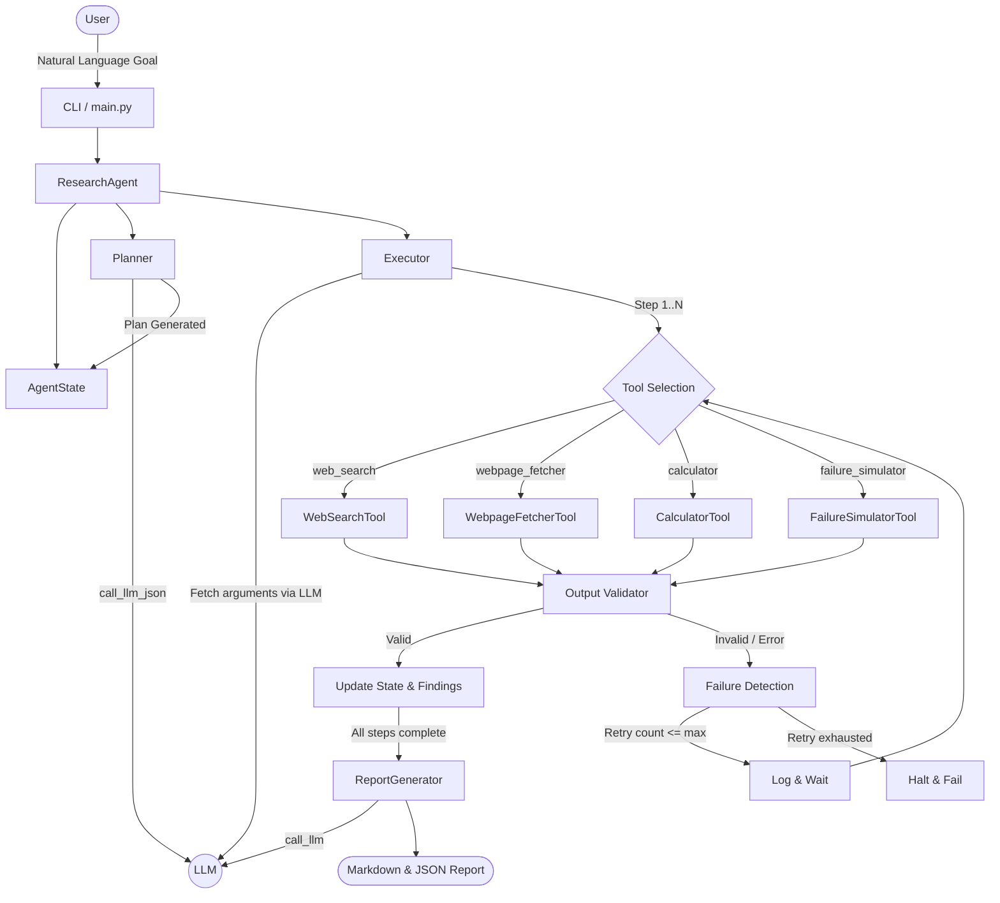

# ResPilot Architecture

## Description
The diagram demonstrates the flow of control and data inside ResPilot. The agent explicitly plans its steps before executing them. Tools are invoked dynamically. When a tool fails or returns invalid data (e.g. simulated by the FailureSimulator), the Validator triggers the Failure Detection flow which loops back to Tool Execution with a retry counter.
